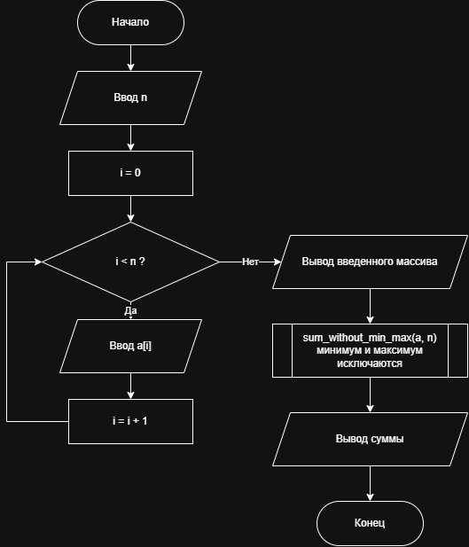

# Домашнее задание к работе 13

## Условие задачи (Вариант 11)

Дан одномерный массив из `n` вводимых с клавиатуры положительных и отрицательных целых чисел.
Найти сумму всех элементов массива, за исключением минимального и максимального значения.

---

## 1. Алгоритм и блок-схема

### Алгоритм

1. Задать константу максимального размера массива `MAX_SIZE = 100`.
2. Настроить локализацию (`setlocale`) для корректного вывода русских сообщений.
3. Запросить у пользователя размер массива `n` и проверить, что значение лежит в пределах от `1` до `100`.
4. В цикле от `0` до `n - 1` считать элементы массива `a[i]` с клавиатуры и вывести введенный массив на экран.
5. Вызвать функцию `sum_without_min_max(a, n)`:
   - найти индекс минимального элемента `idx_min` (первое вхождение минимума);
   - найти индекс максимального элемента `idx_max` среди всех элементов, кроме `idx_min` (если такого нет, то `idx_max = -1`);
   - просуммировать все элементы, индексы которых не равны `idx_min` и `idx_max`;
   - вернуть полученную сумму.
6. Вывести сумму на экран и завершить программу.

### Блок-схема

### 

---

## 2. Реализация программы

Исходный код программы: [Source.c](Source.c)

---

## 3. Результаты работы программы

Пример 1 — массив из 5 элементов, минимум `-3`, максимум `8` (сумма `5 + 0 + 4 = 9`):

```
Введите количество элементов массива (от 1 до 100): 5
a[0] = 5
a[1] = -3
a[2] = 8
a[3] = 0
a[4] = 4

Введенный массив:
5 -3 8 0 4 

Сумма элементов массива за исключением минимального и максимального: 9
```

Пример 2 — массив из 3 элементов, минимум `-4`, максимум `10` (остается `2`):

```
Введите количество элементов массива (от 1 до 100): 3
a[0] = -4
a[1] = 2
a[2] = 10

Введенный массив:
-4 2 10 

Сумма элементов массива за исключением минимального и максимального: 2
```

Пример 3 — массив из 3 одинаковых элементов `3 3 3` (минимум и максимум выбирают два разных элемента, остается `3`):

```
Введите количество элементов массива (от 1 до 100): 3
a[0] = 3
a[1] = 3
a[2] = 3

Введенный массив:
3 3 3 

Сумма элементов массива за исключением минимального и максимального: 3
```

---

## 4. Информация о разработчике

- **ФИО:** Кочанов Кирилл Романович
- **Группа:** БОТИ-261
